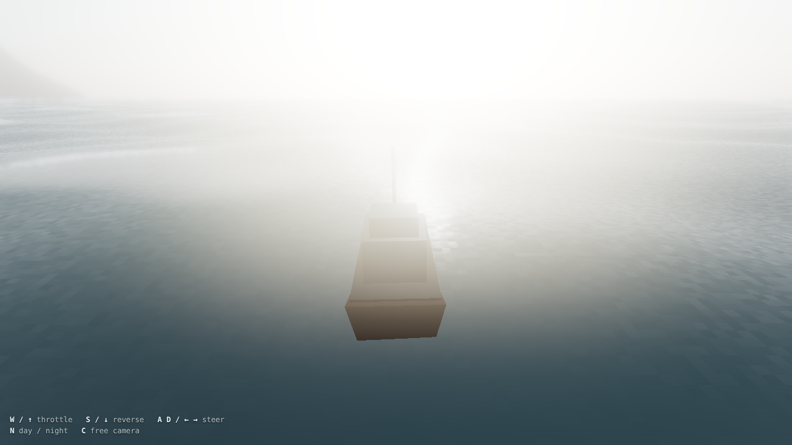
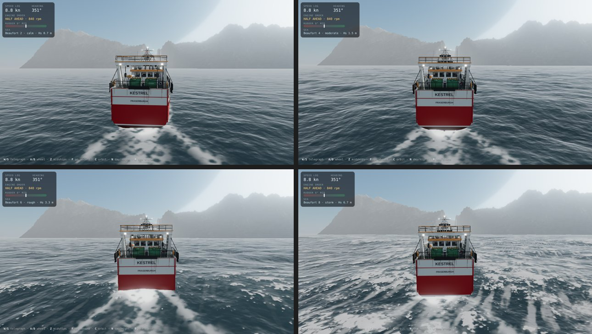
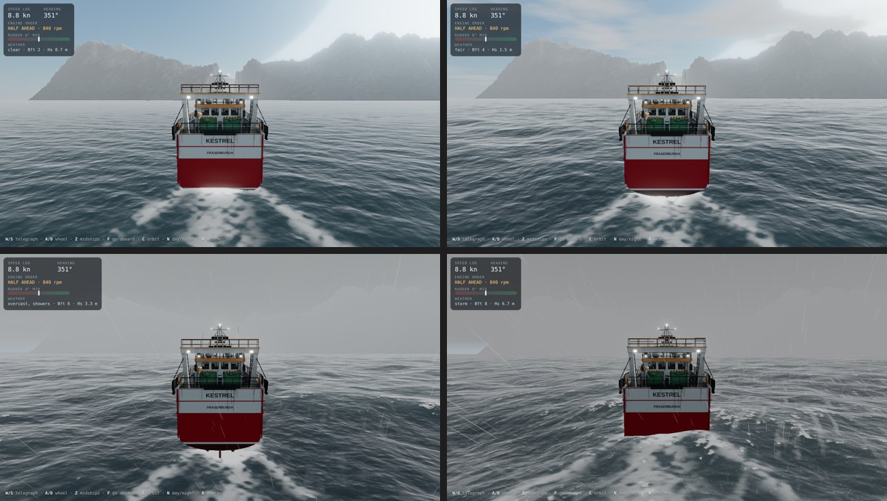
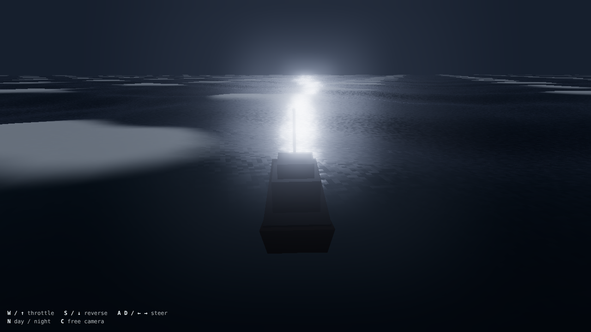
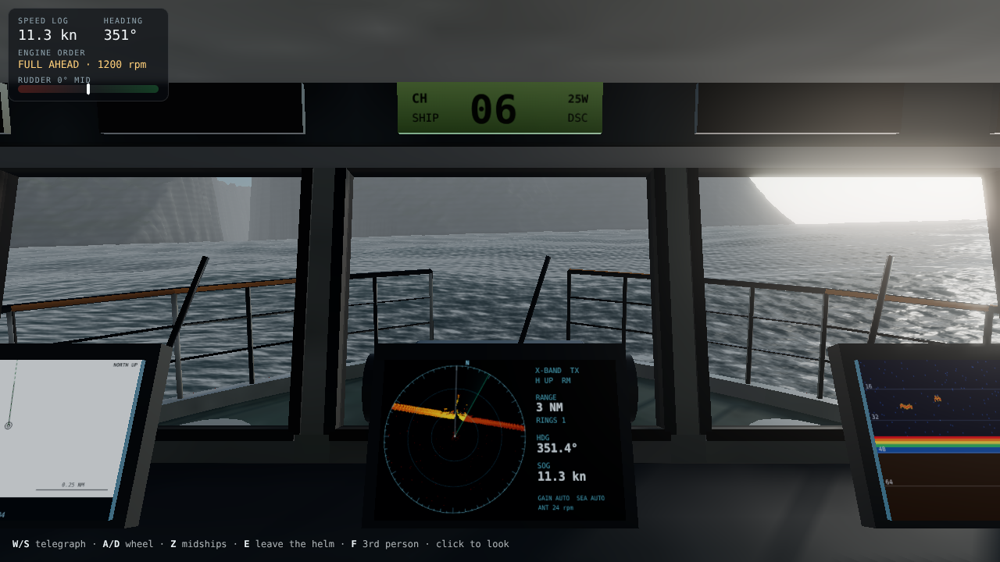
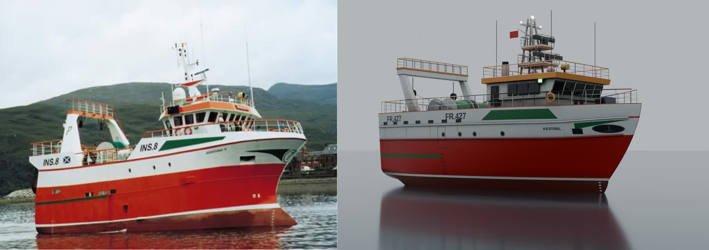
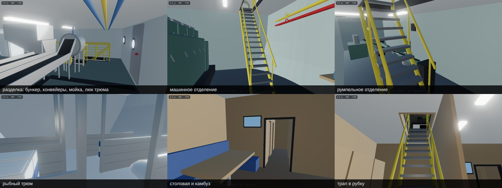

# Open World — Ocean

Atmospheric open-world ocean prototype in the browser, built with **three.js**.
Inspired by the filmic "boat sailing through a fjord" look: a spectral (FFT)
ocean, hazy distance fog, a chase camera and a drivable trawler, all graded
with ACES tone mapping and bloom. The land and the sea floor are real: the
Reine area of Lofoten, Norway, from open elevation and bathymetry data.

> **Change of course (November 2026).** The game is turning to sailing a large
> old ship, a galleon of about 1600-1630, in a dark, misty world. The trawler
> and everything built for her (bridge systems, trawl, quay, people aboard) are
> put away for now: `SHIP.trawler` in `src/config.js` is `false`, which hides
> her model, people and quay and leaves a camera looking round the spot she
> lay at. The houses are gone from the land: only the terrain and its stones
> remain, as the map and the height model give them. The sections below
> describe the trawler as it was built.

## The galleon

A large sailing ship of the 1620s, carrying both guns and cargo, built after
the Swedish royal ship **Vasa** (1628), the one ship of that age that survives
whole. `blender/build_galleon.py` builds her in Blender from Vasa's recorded
dimensions (47.5 m between perpendiculars, 11.7 m beam, 4.8 m draught, 52.5 m
from keel to main truck, a 23 deg rudder) and was checked view by view against
the photogrammetry the Swedish National Maritime Museums published of the ship
herself (looked at in the Sketchfab viewer, not downloaded):

* hull: flat floor, hard bilge, greatest breadth at the lower gundeck, strong
  tumblehome; six heavy wales; 24 ports in two tiers with lids, plus ports in
  the castles; oak strakes with seams, butts, weathering (painted texture);
* stern in tiers, as on Vasa: planked tuck with the stern chasers, counter, a
  cornice on carved brackets, the great cabin's gallery fronted by standing
  figures, the upper gallery as an arcade, the arms (our own emblem: an
  eight-pointed star in a ring over a wave) between two supporters, the
  crest, carved posts at the corners, three lanterns; fluted, two-tier quarter
  galleries; carved figures are the game's Rocketbox person (MIT), posed;
* beakhead with head rails, grating and a leaping lion figurehead;
* bowsprit with sprit topmast; fore and main masts with topmast and
  topgallant, mizzen with topmast; round tops; shrouds on deadeyes and
  channels with ratlines, stays, backstays; eleven yards as separate nodes.

The sails are made in the game (`src/ship/Sails.js`): ten, as on Vasa, set or
furled by steps, filling with the wind, shivering when it comes too far
forward and taken aback when it comes ahead; the yards brace round by
themselves. `src/entities/Galleon.js` sails her: apparent wind, a square-rig
drive curve (nothing closer than about 60 deg to the wind), leeway, heel,
1200 t that carry their way, rudder that answers only with way on. She starts
off **Vindstad** in Reinefjorden, the largest stretch of level land beside deep
water in the area, where a harbour could be built.

Controls: **A/D** rudder, **W/S** set / take in sail; on a phone the stick
(sideways rudder, up and down sail). The model is packed by
`tools/pack_glb.sh` (quantized, gzipped; the game unzips it with fflate).

This is **Phase 1**: a correct, extensible skeleton. The visuals are deliberately
achieved with cheap shader tricks so the architecture (systems, physics, camera,
presets) is real and won't be thrown away as we raise fidelity.








## Run it (Windows / macOS / Linux)

Requires [Node.js](https://nodejs.org/) 18+.

```bash
npm install
npm run dev
```

Then open the printed URL (default http://localhost:5173). For a production
build: `npm run build` then `npm run preview`.

### Controls

You can command the ship from outside, stand at the wheel, or walk about her.

| Key | Third person / at the helm | Walking aboard |
| --- | --- | --- |
| `W` / `S` | engine telegraph one step ahead / astern | walk |
| `A` / `D` | wind the wheel to port / starboard | strafe |
| `Z` | wheel midships | |
| `E` | leave the helm | take the helm (standing at the wheel) |
| `F` | switch third person ↔ first person at the helm | back to third person |
| `Shift` | | run |
| mouse | (click to capture) look around | look around |
| `N` / `C` | day ↔ night / orbit camera (third person) | |
| `B` | weather: clear → fair → overcast with showers → storm → changing on its own | weather |
| `M` / `H` | sound on / off / ship's whistle (hold) | sound on / off / whistle (on the bridge) |
| `J` | dive in (off the starboard quarter) | over the side you stand nearest |
| `P` | bridge console (lights, equipment, power, alarms) | the console on the bridge, the switchboard in the engine room |
| `U` | autopilot on / off (holds the present heading) | |

In the water (a scuba diver):

| Key | |
| --- | --- |
| `W` `A` `S` `D` | swim where you look (look down and swim on to dive) |
| `Space` / `C` | up / down |
| `Shift` | fin harder |
| `L` | dive light on / off (it comes on by itself when deep or dark) |
| `E` | climb the ladder aboard (at the ship's side, at the surface) |

On a phone the interface is in Russian and kept out of the way:
- **Bottom left**: a joystick, always in the same place. At the conn it works
  like the helm joystick of a modern wheelhouse: push it left or right and
  the rudder goes over in proportion, let go and it comes back to midships;
  hold it up or down to step the engine order. Aboard, it walks you about.
- **Bottom right**: the engine-order telegraph lever, to go straight to an
  order: slide it up for ahead, down for astern.
- **Anywhere else**: drag to look around (aboard) or to fly the camera around
  the ship (third person). Pinch with two fingers to zoom.
- **Top right**: *на борт / со стороны* switches view, *к штурвалу / отойти*
  takes or leaves the helm, *нырнуть* goes over the side, and ☰ opens
  day/night, weather, sound and horn.
- **In the water**: the joystick swims where you look, ▲ / ▼ on the right
  (held) go up and down, *фонарь* is the dive light, *на борт* appears at
  the ship's side.
- Hints fade after a few seconds, and a short how-to shows on start.

On desktop, drag the mouse to orbit the ship and use the wheel to zoom.
If you fall over the side or down a gap into the hull, you are put back where
you last stood on deck.
Sound starts with your first tap (browser rule). On an iPhone the ring/silent
switch must be on ring to hear it.

### Ship handling

The trawler is driven like a real vessel, not an arcade boat:

- **Engine-order telegraph**: full / half / slow astern, stop, dead slow /
  slow / half / full ahead. Engine rpm follows the order with a lag; thrust
  scales with rpm² and falls off with speed (propeller in nozzle, 20 t bollard
  pull per the data sheet).
- **Mass and resistance**: ~450 t with added mass and quadratic hull
  resistance: about 9 kn after 20 s at full ahead, 12 kn flat out; after
  STOP she still carries ~4 kn half a minute later.
- **Steering**: you wind a wheel order; the steering gear follows at
  2.5 °/s up to 35°. A first-order Nomoto model turns rudder into rate of turn
  and needs water flow (way on, or propeller wash). Full rudder at full
  ahead gives a ~65 m turning radius, ~4° outward heel and some speed loss.
- Instruments on screen: speed log (kn), gyro heading, telegraph and rpm,
  rudder angle indicator with the wheel order.

### Getting about the ship

`src/ship/ShipAccess.js`. Besides the decks and the spaces below, you can go
up onto the wheelhouse roof (life rafts, satellite domes, funnel, horn,
searchlight), the upper radar platform on the mast and the walkway on top of
the gantry; each has its guard rails. Ladders: up the starboard side of the
wheelhouse from the side deck, up the mast from the roof (past the lower radar
platform, which lies under the upper one and is for servicing only) and up
the starboard gantry leg from the working deck. At the foot or the head of a
ladder press `E` (or the action button), then go up and down it with W / S.
Coming near a piece of equipment or into a space and looking at it, a line at
the bottom of the screen says what it is and what it is for (about 45
places, from the trawl doors to the ice locker).

### The spaces below at work

`src/ship/Stations.js`. Coming to a machine or a fitting, the line at the
bottom of the screen also gives its live state from the ship's systems, and
`E` does what can be done there:

- **engine room**: the main engine's local readings (rpm, oil pressure,
  water temperature, fuel) and local start/stop; each generator with its
  state, load and frequency, started and stopped from its local post; the
  hydraulic power pack; the air compressor and its 250 l receiver with a
  pressure gauge; the bilge pump (pump out by hand); the day tank, whose
  sight glass shows its real level as the engines draw from it and the
  transfer pump tops it up from the main tanks between 60 and 95 %;
- **steering flat**: the rudder angle on the indicator; the standby pump;
  the emergency tiller: with both pumps gone (a blackout), take it and put
  the rudder over by hand (left/right), slowly, as on a real ship;
- **fishroom**: temperature and the catch by species; the pens fill with
  boxes as the catch comes down and empty when it is landed;
- **galley, mess, washroom**: cook (the range draws 6.5 kW on the
  switchboard for twenty minutes), make coffee, watch television, take a
  shower (the 3 kW boiler heats up again);
- **fish handling**: after a haul the catch is worked for a few minutes
  (about 0.3 s per kilo, at most 15 min): the fish ride the conveyors from
  the reception hopper past the gutting places, up the lift into the washer,
  and the line at the bottom says how much is left;
- **cabins**: lie down for a rest in a bunk; the escape scuttle from the
  corridor up to the foredeck.

Doors in the 'tween deck (fish handling to changing room, to galley and
mess, to the cabin corridor, the four cabins, the washroom) swing open as
someone comes to them and close behind. Each space has its own sound, placed
where it comes from and heard through the steel: the air compressor knocking
when it runs, the hydraulic pump's whine, the conveyors while the catch is
worked, the shower, the television.

### Bridge electronics, sensors and the ship's power

Everything aboard runs on the ship's own power and shows what its sensors
measure, not the game's exact state (`src/ship/`, `src/ui/Instruments.js`):

- **Power plant** (`Electrical.js`, a typical arrangement for a 24 m stern
  trawler, not one vessel's drawings): two diesel generator sets of
  80 kVA / 64 kW, 400 V 50 Hz, on a main switchboard with a breaker per
  generator and per consumer: steering-gear pumps, engine-room fans, fuel
  separator, fish-hold refrigeration (thermostat), the winch hydraulic power
  pack, bilge pump (float switch), fresh-water pump, heating (cabin
  thermostat, 3 °C outside), hot water, galley (busy before meals, local
  time), lighting, deck floods, searchlight, navigation supply through a UPS,
  24 V chargers. Starting a big motor pulls the frequency and voltage down
  for a moment. Above full load the non-essential consumers are shed
  (preferential trip); above 115 % the generator breaker trips and the ship
  blacks out: the steering pumps stop (the rudder stays where it is), the
  230 V lights go out and the 24 V emergency lights come on, the bridge
  electronics run on the UPS, and a standby generator on AUTO starts and
  closes onto the dead bus by itself. Paralleling a second generator needs
  synchronising: match its speed, close at twelve o'clock on the
  synchroscope (or let the auto-synchroniser do it); closing out of phase
  trips it. 24 V: house battery 2 x 225 Ah and a start battery, charged by
  the chargers and the main engine's alternator; generators and the main
  engine crank from the start battery. Fuel is used by load.
- **Sensors** (`Sensors.js`), each with its supply (UPS or 24 V) and
  start-up time:
  - GPS: real coordinates (UTM 33 to WGS84, Reine 67°55.96'N 013°05.34'E),
    an error wandering over a couple of metres, about 40 s to a fix after
    power-on;
  - satellite compass: true heading with the meridian convergence of the
    UTM grid allowed for (about 1.7°), a minute to align;
  - magnetic steering compass: needs no power. Declination +7.5° E (WMM2025
    for Reine, November 2026), a deviation card, a swinging card, and
    heeling and turning errors (the field dips 77° this far north);
  - speed log;
  - echo sounder: depth from the transducer in the keel, with the real tide
    and heave, drop-outs in aerated water;
  - masthead anemometer: apparent wind, true wind worked out from it;
  - barometer, air and sea temperature;
  - main engine: rpm (idling at 600 when stopped in gear), oil pressure,
    coolant, exhaust, boost, fuel rate, with real lags. The main engine can
    be stopped and started.
- **Autopilot**: holds a set course on the sat compass through the steering
  gear (no pumps, no steering), off-course alarm; taking the wheel or the
  stick overrides it. **BNWAS** while on autopilot: confirm you are awake
  every 6 minutes, or the bridge alarm sounds, then the master is called.
- **Alarms**: an alarm and monitoring list (blackout, generator trip,
  overload, steering failure, UPS on battery, low 24 V, shallow water,
  off course, GPS and compass loss, navigation light failure, bilge, hold
  temperature, engine oil pressure...), each staying until cleared and
  acknowledged; the buzzer sounds while any is unacknowledged.
- **The screens**: dark without power, a start-up screen while booting (the
  radar's magnetron warms up for 90 s), then:
  - radar: X-band, head-up on the sat compass, 24 rpm. It paints the real
    terrain from a 9.5 m antenna with radar shadow, transmit/standby;
  - chart plotter: the ship at its GPS position, real lat/lon graticule,
    track, COG/SOG vector; NO FIX without GPS;
  - echo sounder: depth below the surface and under the keel;
  - conning display: sat-compass and magnetic headings, rate of turn,
    rudder, SOG/STW, apparent and true wind, barometer trend, autopilot,
    BNWAS;
  - engine monitor: main engine, generators, bus, 24 V, fuel, latest alarms.

### Lights

`src/ship/ShipLights.js`, all on the ship's power:

- **Navigation lights** to COLREG, each with its own switch: masthead,
  sidelights, stern light, trawling (green over white), anchor,
  not-under-command. Presets on the panel: underway, trawling, anchor, NUC.
  Each light is seen only inside its sector, with the 1-3° cut-off of
  Annex I: go round the ship at night and you see what another vessel's
  lookout would. Ranges for a vessel of 12-50 m. They are 24 V LED lanterns
  and keep burning in a blackout.
- **Deck floodlights**: metal-halide, aft working deck and foredeck. They
  warm up from a dim blue-green glow over about a minute, and once switched
  off hot they cannot strike again until cool (90 s). They light the deck
  and the water around the ship.
- **Searchlight**: 1 kW on the wheelhouse roof, aimed from the panel (or
  where you look). Its beam shows in the night air and where it meets the
  water; it lights the shore.
- **Inside**: 230 V lighting below decks, 24 V emergency lighting in a
  blackout; red night light or white light in the wheelhouse.

### The whistle

`src/ship/Whistle.js`, voice in `src/systems/Sound.js`: an air horn (tyfon)
on the wheelhouse roof, blown by working air from a 250 l receiver kept at
7.5-9 bar by a compressor on the switchboard, through a 24 V solenoid valve.
COLREG Annex III puts the fundamental at 250-700 Hz for a vessel under 75 m
(130 dB at 1 m, heard about a mile), so this is one deep tone (290 Hz), not
the two-note chord of a car horn. It is synthesised from how such a horn
works: a diaphragm buzz rich in harmonics, the trumpet's resonances around
1.1 and 2.6 kHz, the note blooming up to pitch with a bark of air as the
valve opens and sagging as it closes, weak and flat on low air. It reaches
you at the speed of sound and comes back off every cliff within 1.5 km.
Hold `H` (or *гудок*) for as long as you like. The *Тифон* tab gives the
Rule 34 manoeuvring signals (one short: altering to starboard; two: to port;
three: astern propulsion; five: doubt; prolonged: a bend) and a fog-signal
timer for Rule 35 (making way; underway, stopped; fishing / NUC), every
2 minutes.

### Anchoring

`src/ship/Anchor.js`: the starboard bower anchor with 7 shackles of chain
(192.5 m) and a hydraulic windlass driven by the deck-machinery power pack.
Let it go and it runs out under its own weight, the chain rattling through
the hawse; pay out 3-5 times the depth and set the brake. The ship then
drifts with the wind (a stopped trawler makes leeway of about 3 % of the
wind speed; the GPS course over the ground shows it) until the chain
fetches up, and lies to it bow-on, swinging round the anchor. Too short a
scope, too much wind or the engine pulling against it and the anchor drags.
The anchor watch compares the GPS position with the swinging circle and
raises the alarm. Heaving up needs the hydraulics running on the
switchboard: 9 m/min, pulling the ship up to her anchor until it breaks out.
The chain hangs from the hawse and lies along the bottom to the anchor, so
you can see it when diving.

### Trawling

`src/ship/Trawl.js`: a bottom trawl worked from the stern, the way a 24 m
stern trawler does it. On the *Трал* tab: **Shoot** while steaming slowly
ahead: the net runs off the net drum over the stern ramp, the doors (otter
boards) are hung off the gantry blocks and the warps run off the two trawl
winches to the length you set (about three times the depth). **Brake** and
tow at 3-3.5 knots: the doors spread the net (wing spread about 22 m) and
the ground gear runs over the bottom; the warp counter, the depth under the
trawl, door spread and "on the bottom" come from the trawl sensors on the
UPS. Too little warp or too much speed and the gear lifts off; over hard
ground it can come fast (a fastener: the warps bar-taut and the ship
brought up; hauled back over it the trawl usually comes free, sometimes
torn and empty). The gear's drag, 6-8 tonnes on the bottom, loads the
engine and slows the ship. **Haul**: the winches heave at 60 m/min on the
hydraulic power pack (34 kW, an essential consumer on the switchboard: with
the hotel load on, the standby generator starts), the net is wound in and
the cod-end swung aboard. The catch depends on where the trawl went: depth,
hard or soft bottom and patches of fish that stay where they are; by
species (cod, haddock, saithe, redfish, plaice) into an 18 t fish room.
Trawling inside 12 nautical miles of the Norwegian baselines is generally
not allowed; the game does not enforce it, the panel only says so.

### The quay at Reine, shore power, landing the catch

`src/ship/Harbour.js`: a fish-landing wharf on the west shore of Reine,
between the registered sea houses. The site was searched for on the height
model: a wharf built out 13-18 m on piles, with about 6 m of water under a
ship alongside and an open approach. Concrete deck, rubber fenders,
bollards, a ladder, a quay crane, fish tubs and boxes, a lamp post and a
shore-power pillar. On the *Причал* tab: come alongside slowly (under a
knot), parallel to the face and 5-15 m off, and **moor**: the ship is
brought in to the fenders and held by bow and stern lines and springs,
still riding the tide and the swell. The echo sounder's shallow alarm is
off alongside. Moored, you can:

- **Plug in shore power** (400 V 50 Hz, 125 A, about 69 kW) and change
  over on the switchboard. Shore and generators cannot be paralleled: the
  shore breaker is interlocked with the generator breakers and closes only
  onto a dead bus. *Change over to shore* puts the standby generator to
  manual, takes the generators off the board, closes the shore breaker
  (under a second without power; the motors restart in sequence) and stops
  the generators. *Back to the generators* starts one, opens the shore
  breaker and closes the generator onto the dead bus. The shore supply is
  stiff (50.00 Hz, the voltage drops a little along the cable), metered in
  kWh and billed when you leave. Overload it and the preferential trip
  sheds the non-essential consumers; beyond 115 % the shore breaker trips.
  Leave with the cable still plugged in and it is torn out: blackout.
- **Land the catch**: the fish room is sold by species to the buyer on the
  quay (prices rough, NOK per kg).
- **Take on fuel**: marine gas oil to full tanks (14 000 l).

### VHF radio

`src/ship/Radio.js`, the *УКВ* tab: the bridge VHF with DSC, on the 24 V
supply. International maritime channels (6, 8, 9, 10, 12, 13, 14, 16, 26,
67, 69, 72, 73, 77), dual watch with 16, 25 W / 1 W, volume; RX and TX
lamps. What is on the air is generated and heard only on the channel it is
sent on: the coast radio's sécurité announcements on 16 with the weather or
a navigational warning read on its working channel; Norwegian fishermen
talking on 72 and 77; a yacht calling the Moskenes ferry on 16 and moving
to 13; a netter warning you off. You can:

- call the coast radio for the weather: on 16 it asks you to go to 26;
  change channel and it reads the coastal forecast for Vestfjorden, made
  from the game's weather (wind direction and speed, trend, rain,
  visibility, wave height, a gale warning above 14 m/s);
- call the fish reception at Reine on 12 for a berth;
- send a DSC distress alert (lift the cover, press again within 5 s): the
  digital call goes out on 70 with the MMSI and GPS position, the coast
  station acknowledges on 16, and you cancel the false alert by voice on 16
  as the GMDSS procedure goes.

The voices are the browser's speech synthesis (English; Norwegian where the
device has a Norwegian voice, otherwise the sound of speech through the
loudspeaker). Squelch noise opens and closes around each transmission; the
loudspeaker is in the wheelhouse, faint on deck. The log on the panel shows
each transmission with a Russian translation. The vessel names, the ship's
MMSI and the coast radio's working channel are fictional.

### The person aboard

The man the ship came to, who runs her himself. He is not modelled here: he
is a ready-made, professionally built avatar from the **Microsoft Rocketbox
Avatar Library** (`Male_Adult_07`, MIT licence,
<https://github.com/microsoft/Microsoft-Rocketbox>): a realistic man of about
40 in a grey jacket and jeans, 1.82 m, one skinned mesh of 7 600 triangles on
the library's Biped skeleton, with its colour and normal maps. His animations
are the library's own motion capture: standing (two takes), looking about,
walking, jogging. `blender/build_person.py` converts the avatar and the takes
for the game (`public/models/person.glb`, 2.6 MB): the takes are retargeted
onto the avatar bone by bone (their rest pose has the arms level, the
avatar's has them down), textures are resized to 1024 px with the islands
bled so their edges do not pick up the background. In the game
(`src/entities/Crew.js`) you see yourself when you walk about the ship with
the camera behind you (`V`, or *1-е/3-е*): standing, now and then looking
about, walking, jogging; steering from the outside camera you see him at the
controls in the wheelhouse.

**Panels** (`src/ui/ShipPanels.js`): `P` (or *пульт*) opens the bridge
console, at the conn or on the bridge. Its tabs: navigation lights; deck
lights, searchlight and wheelhouse light; equipment power switches,
autopilot and BNWAS; the power plant with remote start/stop of the
generators and the main engine; alarms. At the main switchboard in the
engine room (forward bulkhead, port side), `P` (or *щит*) opens the
switchboard itself: generator meters, synchroscope, breakers, speed trim,
standby mode, every consumer breaker with its load, batteries and UPS.
`U` engages the autopilot.



## How it's built

The realism here is **not** the engine — it's the water shader + fog + post.

- **Ocean waves** (`src/world/OceanSpectrum.js`, `OceanFFT.js`): a spectral
  sea after Tessendorf, the method used for film and AAA oceans. Wave
  amplitudes are drawn at random from a **JONSWAP** spectrum (fetch-limited
  wind sea from wind speed and fetch) plus a long swell, with Mitsuyasu
  directional spreading. The GPU advances the spectrum in time and runs an
  inverse FFT every frame for three cascades (patches of 2000 m, 120 m and
  19 m; 1000 m on phones), so wavelengths from ~1 km down to 30 cm are
  covered without visible tiling. The output is displacement (including
  choppy horizontal motion) and slope derivatives. Sea states run from
  Beaufort 2 to 8. The simulated significant wave height matches the
  spectrum (Hs 1.5 m at Bft 4, 6.7 m at Bft 8), and the sea builds up or
  calms over a few seconds when you change it.
- **Not uniform, like a real sea** (`src/world/Ocean.js`): the long waves die
  down behind the islands and up the fjords (each point's openness to the
  sea is worked out from the real coastline, see below) and the swell is
  damped where the real sea floor shoals. Drifting
  wind gusts (cat's paws) roughen the small waves in patches. Whitecaps
  appear where the summed surface folds over (Jacobian) and leave foam that
  fades. A gale blows foam into streaks along the wind, and there is surf at
  the foot of the cliffs.
- **Weather** (`src/world/Weather.js`, `CloudLayer.js`, `Rain.js`): one
  state drives the sky, light, fog, sea state, clouds and rain together, and
  a front blends over 12 s. It has four states, plus *changing*, in which the
  weather wanders by itself every few minutes:

  | weather | sea | clouds | rain | sun | fog |
  | --- | --- | --- | --- | --- | --- |
  | clear | Bft 2 | few | none | full | light haze |
  | fair | Bft 4 | broken cumulus | none | full | normal |
  | overcast, showers | Bft 6 | grey deck | showers | weak | thicker |
  | storm | Bft 8 | low dark ceiling | heavy, slanting | almost none | ~1.5 km visibility |

  The clouds are a deck ray-cast in the sky shader. They drift with the wind,
  the cloud base comes down as the weather worsens, and they fade into the
  haze. Rain is wind-slanted streaks in a box around the camera, culled inside
  the wheelhouse, plus rings on the water. A storm adds lightning. Under
  cloud the sea reflects grey, the sun glitter goes and the shadows soften.
- **Sound** (`src/systems/Sound.js`): fully procedural, spatial Web Audio
  with no sound files. The camera is the listener. Point sources sit in the
  world and fade with distance, carry direction (HRTF on desktop) and lose
  their highs far away (air absorption).
  - **The ship**: the diesel exhaust (a 6-cylinder four-stroke, 600–1200 rpm),
    water sloshing against the hull with the motion, bow wash, rigging
    whistling in a gale, VHF chatter on the bridge, and the horn (`H`,
    340/425 Hz).
  - **The land**: surf on the nearest cliffs, found by scanning the terrain
    around you, so it gets louder as you close the rocks. Gulls call near the
    shore and over the ship in fair weather; there are none at night or in
    rain.
  - **The sky**: thunder from the strike point, arriving distance / 343 m/s
    after the flash, with a crack when it is close.
  - **Everywhere**: open-sea waves (quieter up the fjord), wind with gusts,
    rain.
  - **Aboard**: the engine through the hull and the hull creaking as she
    rolls. From the wheelhouse the outside is muffled and rain drums on the
    roof; out on deck rain patters.
  - **The fjord rings**: reverb grows with how enclosed you are, and the horn
    comes back as real echoes from every cliff within 1.5 km, delayed by the
    path length.
- **Bow spray** (`src/world/Spray.js`): the bow plunging into a rising sea
  (water rising fast against the bow) throws a sheet of spray to both sides.
  It carries with the ship, blows downwind and falls back; light spray runs
  off the bow wave at speed in a seaway.
- **Waterfalls** (`src/world/Waterfalls.js`): six falls inside the fjords,
  placed where the real terrain has a high, steep face right at the water. Each is two crossed curtains hugging the cliff from lip to sea, with
  streaks accelerating as they fall and mist where they land. They run
  fuller in the rain. The two nearest roar from their foot (spatial sound).
- **Night sky** (`src/world/NightSky.js`): a dark gradient with airglow at
  the horizon, twinkling stars in two layers, the Milky Way with its denser
  star field, and the moon with maria and a halo. The moon lays a path of
  light on the sea, and clouds hide the sky in bad weather.
- **Water shading**: Fresnel sky reflection, sun or moon glitter that widens
  with distance, light scattered through thin crests, the ship's bow wave,
  wake and Kelvin arms, and distance fog. The mesh is a polar grid centred
  under the camera, about 1 m spacing close in.
- **Seakeeping** (`src/entities/Boat.js`): the water height at five points
  under the hull is summed on the CPU from the same spectrum (the ≈1800 most
  energetic wave trains), so the ship rides the rendered sea. Heave, pitch and roll are second-order
  responses with the trawler's natural periods (roll ~8 s), so she rolls
  hardest when the waves meet her rhythm.
- **Sky** (`src/world/SkyDome.js`) — three's physically-based (Preetham) sky;
  the sun direction drives the ocean shader and the directional light.
- **Post** (`src/core/Engine.js`) — `ACESFilmicToneMapping` + `UnrealBloomPass`.
  This is ~half of the "filmic" look.
- **Boat** (`src/entities/Boat.js`) — loads the Blender-built trawler (below),
  with thrust/drag physics, heel in turns and buoyancy over bow, stern and sides.
- **Presets** (`src/config.js`) — day/night are presets of one scene. All
  tuning (colors, waves, fog, bloom, camera, boat) lives here.

## The trawler

The player's vessel is a 23.95 m Scottish stern trawler built procedurally in
Blender by `blender/build_trawler.py` and exported to `public/models/trawler.glb`.

Reference data, all from Macduff Ship Design's page for the 23.95 m trawler
*Adventurer II*:
- data sheet: LOA 23.95 m, LBP 20.00 m, breadth 9.20 m, depth 4.00 m, 337 GRT,
  2.7 m propeller in nozzle, 3 split winches, 4 net drums, crane;
- general-arrangement profile drawing: every height and position (freeboard,
  stripes, shelter deck, wheelhouse, mast platforms, raked A-frame, drums) was
  measured off it;
- delivery photo: livery, railings, equipment.

The draught (3.0 m) is assumed. Name and registration are our own. Hull
livery and ambient occlusion are baked into textures (hull 4096x1024,
fittings atlas 2048).



Rebuild the model (needs Python 3.13; takes ~3 minutes):

```bash
python3.13 -m venv .blenv && .blenv/bin/pip install bpy==5.2.3 pillow
.blenv/bin/python blender/build_trawler.py -- out --render
cp out/trawler.glb public/models/trawler.glb
```

### Below decks

The published drawing is an outboard profile only, and no complete general
arrangement of a 24 m Scottish trawler with its interiors is openly
available. The arrangement is therefore worked out from how this boat works
from outside, and from documented arrangements of comparable UK trawlers:

- Parkol Marine (Whitby) yard descriptions of their 19-22 m trawlers
  (e.g. *Sparkling Star*, *Our Lass II*, *Jubilee Quest*, *Day Dawn*):
  below deck three watertight bulkheads divide aft accommodation with the
  steering gear, the engine room, the fishroom with its ice locker and the
  forepeak tank; on the main deck an athwartships casing holds galley, mess,
  oilskins and washroom; fish handling, hopper and ice machine are in the
  shelter.
- FAO *Fishing boat designs* (Fisheries Technical Papers 188 and 239) for
  the general practice: fishroom divided into pens about 1.5 m long by
  stanchions and pound boards either side of a centre gangway, ice stowage,
  steering gear over the rudder, engine room access.

How the spaces follow from the boat itself (stations s from the transom):

- **The catch path.** The codend comes up the stern onto the working deck
  and is emptied through the hatch in the deck (s 8.15). Below it, on the main
  deck at 2.15 m, the reception hopper feeds a conveyor that carries the fish
  aft past the crew; they gut standing inboard of it and put the fish on a
  second conveyor that lifts them into the washer drum; from the washer a
  chute goes down through its own hatch into the fishroom. Offal runs in the
  floor gutter to the side discharge door (the door on the drawing). The ice
  machine stands beside the chute and drops ice into the ice locker below.
- **Fishroom** (s 9.4-16.4, about 160 m³ gross as on the data sheet), right
  under the fish handling: insulated and white, aluminium stanchions and
  pound boards in pens about 1.5 m long, boxed fish and bulk ice, the ice
  locker aft, refrigeration grids on the deckhead, a stair down from the
  hatch.
- **Engine room** (s 3.0-9.4), aft of the fishroom so the shaft is short:
  main engine (1500 hp, six in line) with gearbox aft, coupling and stern
  gland, turbo and exhaust, a hydraulic pump for the winches and net drums,
  two generator sets, switchboard, day tank, workbench, pipe runs with
  valves. The exhaust goes up a lagged trunk on the port side, along the
  deckhead, across the casing and up through a casing in the wheelhouse to
  the funnel on its roof (which is where the drawing has it).
- **Steering gear flat** (s 0.45-3.0) over the rudder, reached by its own
  hatch from the aft store: rudder stock, tiller, two hydraulic rams, power
  pack, emergency tiller, rudder-angle transmitter.
- **Aft store** under the working deck: the companion from the deck lands
  here; spare net under the stair, ropes, floats, the hatches down to the
  steering flat and the engine room.
- **Casing** (s 11.4-16.6), under the wheelhouse: changing room where the
  crew come in off the deck (lockers, oilskins, boots, bench), washroom (WC,
  shower, basin), galley (stove with fiddle rails, oven, hood, sink, fridge,
  microwave) and mess (settee, table, TV), and the stair up to the
  wheelhouse.
- **Cabins** forward: four two-berth cabins off a centreline corridor, with
  bunk curtains, reading lights and lockers.

Every space is walkable; stairs are 42-57°, as on a working boat. Below decks
the sea is masked out of the hull, the rain does not fall, the outside light
is shut out, the deckhead lights and your own lamp light the spaces, and the
engine is loud in the engine room.



## The land and the sea floor: Reine, Lofoten

The world is a real place: Reine on Moskenesøya in Lofoten, with Reinefjorden
and its arms, the skerries off the village and Vestfjorden outside. You start
in open water south-east of Reine, bow toward the fjord mouth.

- **Land**: Kartverket's national height model (NHM digital terrain model,
  10 m), from the Geonorge WCS (CC BY 4.0).
- **Sea floor**: the EMODnet Bathymetry digital terrain model (mean depth,
  1/16 arc-minute, about 115 x 45 m here), which includes the fjord basins
  (to about 155 m deep in Reinefjorden, 250 m in Vestfjorden).
- `tools/build_terrain.py` downloads both, merges them at the coastline (the
  coarse sea-floor model is limited by a slope off the real shore so rock
  does not drop vertically and narrow sounds keep water), smooths the
  sea-floor facets and writes two grids: 10 m over the 10 x 11 km you sail in
  and 64 m over 41 x 41 km so the mountains on the horizon are real too. It
  also works out how open each point is to the sea (fetch along 32 bearings)
  for the wave shelter. Output: `src/assets/terrain/` (about 1.7 MB).
- In the game (`src/world/Terrain.js`) the same heights answer the boat
  (grounding), camera, radar, echo sounder and chart, and drive the mesh: a
  quadtree of patches, finer near the camera, drawn as one instanced draw
  call with the heights read from a texture in the vertex shader.
- **What the ground is**: NGU's map of superficial deposits (bare rock,
  scree, moraine, beach, wind-blown sand, weathered material) and its
  1:250 000 bedrock map (monzonite to granite, migmatitic gneiss, gabbro),
  read into the same 10 m cells by `tools/build_landcover.py`. The shader
  draws what the map says is there: pale rubble on the scree fans, green
  stony moraine, beaches, dark gabbro, banded gneiss; mountain lakes are the
  real ones (dead-flat areas in the height model). Height and slope add
  snow on the high ledges and vegetation only where it can hold.
- **Stones**: blocks on the scree, erratics on the moraines and cobbles on
  the beaches, placed by the deposit map around the camera (instanced,
  refreshed as you move) and coloured by the bedrock under them.
- **The tide**: Kartverket's predicted high and low waters for Reine
  (`src/assets/terrain/tide.json`, Nov 2026 - Dec 2027). The sea level in the
  game follows the real clock (about 2.4 m range at springs), so the wet band
  on the rocks, the shallows and what you can sail over change through the
  day; the bridge shows the tide and whether it is rising or falling.
- **The village**: every building in Kartverket's register (Matrikkelen,
  788 standing buildings in the area) at its registered position, as the
  kind its type code says: houses, cabins, red rorbuer and sea houses on
  posts over the water, boathouses, sheds, the fish plants, shops. The
  register has points, not outlines, so each kind has its typical size and
  form (modelled in `blender/build_village.py`), faces downhill toward the
  shore and stands on a foundation that follows the slope. Stockfish racks
  stand near the fishery buildings (approximate places: they are not in the
  register) and carry cod from February to May.

Honest limits: the land is accurate to about 10 m; the sea floor is the
regional model, so single rocks and the shape of small coves under water are
smoothed. The deposit map is 1:50 000-ish, so its borders are a few tens of
metres off. Buildings are typical shapes at the right place, not the real
house; roads, quays and bridges are not drawn yet (OpenStreetMap could not be
reached from the build environment).

## Under water

Go over the side (`J`, or *нырнуть*) and you are a diver in a drysuit with a
12 litre, 200 bar cylinder of air; the water is about 7 °C in November.

- **Diving as it works**: the vest holds your head out at the surface and is
  let out to go down; under water you are neutral and swim where you look.
  The dive computer shows depth, maximum depth, dive time, ascent rate and
  cylinder pressure. Air goes at about 18 l/min at the surface at rest, more
  when finning, times the ambient pressure (one bar more every 10 m), so the
  same cylinder lasts half as long at 10 m and a third as long at 20 m. It
  warns when you come up faster than 10 m/min, counts down the 3-minute
  safety stop at 3-6 m after a dive deeper than 10 m, and warns past 40 m
  and when the oxygen partial pressure of air passes 1.4 bar (57 m). Out of
  air, you go straight up. Back at the ship's side, climb the ladder aboard.
- **Light in water** (`src/world/Underwater.js`, `WaterOptics.js`): red is
  taken out within a few metres, green goes deepest, blue a little less
  deep (the dissolved organic matter of coastal water). The view fades into
  the water's own colour within about 25-30 m (clear winter water) and
  darkens with depth; the eye's adaptation is allowed for, so it is not the
  unfiltered blue-green of a camera. Looking up, the sky shows only inside
  Snell's window, a circle 97° across overhead with a glowing rim, and the
  surface beyond it is a mirror of the water below (total internal
  reflection). Caustics play on the bottom in the first metres; flecks of
  marine snow drift; each breath out sends bubbles past the mask; the dive
  light lights a cone. Sound goes dull under water, the ship's diesel and
  propeller carry through it, and you hear the regulator: the hiss in, the
  bubbles out.
- **From above**, the sea is see-through where it is shallow, the bottom
  fading with depth and tinted by the water above it.
- **The bottom** (terrain shader): rock on steep bottoms and in patches,
  dark in the kelp zone and crusted pink with coralline algae below it;
  shell sand with ripples in the shallows, finer sand deeper, mud in the
  basins.
- **Life** (`src/world/SeaLife.js`), placed by the same rock-or-sand rule:
  a forest of Laminaria hyperborea on rock from just below the lowest tides
  to about 20 m (stiff stipes furred with red algae, hand-shaped blades,
  thinning to a kelp "park" deeper), sugar kelp in sheltered water, green
  sea urchins at and below the lower edge of the kelp, common starfish, a
  school of saithe in mid water that keeps its distance, and cod by the
  bottom. The kelp sways in the surge of the swell, more in shallow water
  and in a rough sea.

Honest limits: the sea-floor model is coarse (about 100 m), so near land the
bottom drops to several metres within one 10 m cell and wide shallows are
rare; the bottom types and the life are the usual pattern for this coast,
placed by rule, not mapped (Norway's detailed sea-floor maps do not cover
Reine yet). Fish are a simple school, not a simulation of behaviour.

To rebuild the terrain data:

```bash
python3 -m venv .geoenv && .geoenv/bin/pip install numpy scipy tifffile pyproj pillow
.geoenv/bin/python tools/build_terrain.py
.geoenv/bin/python tools/build_landcover.py      # cover.dat, buildings.json, tide.json
blender -b -P blender/build_village.py -- src/assets      
```

## Project layout

```
src/
  main.js              # wiring + main loop
  config.js            # all tunable values + day/night presets
  core/Engine.js       # renderer, camera, post-processing
  world/
    OceanSpectrum.js   # JONSWAP spectrum, cascades, CPU wave sampler
    OceanFFT.js        # GPU time evolution + inverse FFT + foam
    Ocean.js           # water mesh + shaders, sea states, shelter
    Weather.js         # weather states, blending, preset resolution
    CloudLayer.js      # cloud deck
    NightSky.js        # stars, Milky Way, moon
    Terrain.js         # real terrain: data, CPU heights, GPU quadtree mesh
    Tide.js            # sea level now, from Kartverket's predictions
    Village.js         # registered buildings, stockfish racks, boulders
    Underwater.js      # light in water, marine snow, bubbles, dive light
    WaterOptics.js     # attenuation constants + GLSL shared by the shaders
  ship/
    Electrical.js      # generators, switchboard, consumers, protection, 24 V, UPS
    Sensors.js         # GPS, compasses, log, sounder, wind, engine, autopilot, BNWAS
    ShipLights.js      # navigation lights (sectors), floods, searchlight, interior
    Alarms.js          # alarm list: raise, clear, acknowledge
    Whistle.js         # whistle control: signals, fog-signal timer, air
    Anchor.js          # anchor, chain, windlass, drift, dragging, anchor watch
    Trawl.js           # bottom trawl: shooting, towing, hauling, drag, catch, fish room
    Harbour.js         # the quay at Reine: mooring, shore-power pillar and cable, landing, fuel
    Radio.js           # VHF with DSC: channels, dual watch, generated traffic, calls, distress
    ShipAccess.js      # walkable roof, radar platform, gantry; ladders; what each place is for
    Stations.js        # machinery and fittings below: live readings, local controls, gauges
    Geo.js             # UTM 33 -> WGS84, convergence, declination, deviation card
    SeaLife.js         # kelp, urchins, starfish, saithe, cod
    Waterfalls.js      # waterfalls on the fjord walls
    Rain.js            # rain streaks
    Spray.js           # bow spray particles
  systems/Sound.js     # procedural soundscape
    SkyDome.js         # sky + sun direction
    Environment.js     # lights + scene fog
  entities/Boat.js     # placeholder boat + buoyancy/steering
  entities/Diver.js    # the scuba diver: swimming, air, dive computer
  entities/Crew.js     # the person aboard (Rocketbox avatar): you in third person, at the controls
  ui/DiveComputer.js   # dive computer panel
  ui/ShipPanels.js     # bridge console and main switchboard overlays
  systems/
    Input.js           # keyboard -> throttle/steer
    FollowCamera.js    # damped chase camera
```

## Roadmap (next phases)

Known rough edges and the planned path to reference-level fidelity:

1. ~~Cliffs / fjord terrain~~ — done: the real Reine area of Lofoten.
2. **Boat asset** — replace the primitive with a Blender-authored, baked-PBR
   trawler exported as Draco-compressed glTF.
3. **Water fidelity** — detail normal maps, better LOD near the camera, and
   eventually an FFT ocean; screen-space reflections.
4. **Real volumetric fog / god rays** — a raymarched fog post-pass instead of
   the analytic distance fog.
5. **Night sky** — moon disc, stars, and cloud layer (three's Sky is daytime
   only, so night currently uses a dark background + fog).
6. **Audio + world content** — ambient sound, points of interest to explore.
