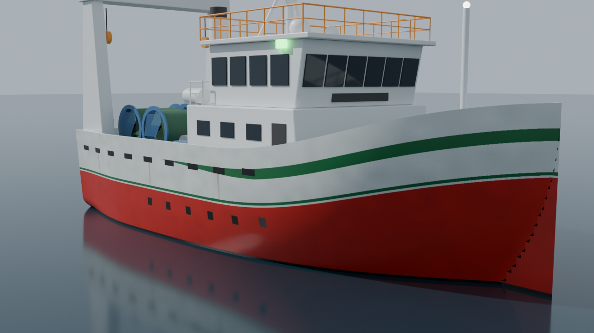

# Open World — Ocean

Atmospheric open-world ocean prototype in the browser, built with **three.js**.
Inspired by the filmic "boat sailing through a fjord" look — a procedural
Gerstner ocean, hazy distance fog, a chase camera, and a drivable boat, all
graded with ACES tone mapping + bloom.

This is **Phase 1**: a correct, extensible skeleton. The visuals are deliberately
achieved with cheap shader tricks so the architecture (systems, physics, camera,
presets) is real and won't be thrown away as we raise fidelity.


## Run it (Windows / macOS / Linux)

Requires [Node.js](https://nodejs.org/) 18+.

```bash
npm install
npm run dev
```

Then open the printed URL (default http://localhost:5173). For a production
build: `npm run build` then `npm run preview`.

### Controls

| Key | Action |
| --- | --- |
| `W` / `↑` | throttle forward |
| `S` / `↓` | reverse |
| `A` `D` / `← →` | steer |
| `N` | toggle day / night |
| `C` | toggle free-look camera (orbit) |

## How it's built

The realism here is **not** the engine — it's the water shader + fog + post.

- **Ocean** (`src/world/`) — a large grid displaced by a set of **Gerstner
  waves** in the vertex shader. The fragment shader fakes water cheaply:
  Fresnel sky-gradient reflection, a sharp sun/moon specular glitter, depth
  color, foam on crests, and distance fog so the water melts into the haze.
  The plane re-centers on the camera each frame and waves are evaluated in
  **world space**, so the ocean is effectively infinite.
- **Single source of truth for waves** (`src/world/waves.js`) — the GLSL is
  *generated* from the same `WAVES` array the JS buoyancy sampler reads, so the
  boat floats on exactly the surface you see (pitch/roll included).
- **Sky** (`src/world/SkyDome.js`) — three's physically-based (Preetham) sky;
  the sun direction drives the ocean shader and the directional light.
- **Post** (`src/core/Engine.js`) — `ACESFilmicToneMapping` + `UnrealBloomPass`.
  This is ~half of the "filmic" look.
- **Boat** (`src/entities/Boat.js`) — a primitive placeholder trawler with real
  buoyancy & steering. **This is the one mesh we swap for a Blender glTF.**
- **Presets** (`src/config.js`) — day/night are presets of one scene. All
  tuning (colors, waves, fog, bloom, camera, boat) lives here.

## The trawler

The player's vessel is a 23.95 m Scottish stern trawler built procedurally in
Blender by `blender/build_trawler.py` and exported to `src/assets/trawler.glb`.
Principal dimensions come from the published Macduff Ship Design data sheet for
their 23.95 m stern trawler design: LOA 23.95 m, LBP 20.00 m, breadth 9.20 m,
depth 4.00 m, 337 GRT, 2.7 m propeller in nozzle, 3 split winches, 4 net drums.
The draught (3.0 m) is assumed. Name and registration are our own.



Rebuild the model (needs Python 3.13):

```bash
python3.13 -m venv .blenv && .blenv/bin/pip install bpy==5.2.3
.blenv/bin/python blender/build_trawler.py -- out --render
cp out/trawler.glb src/assets/trawler.glb
```

## Project layout

```
src/
  main.js              # wiring + main loop
  config.js            # all tunable values + day/night presets
  core/Engine.js       # renderer, camera, post-processing
  world/
    waves.js           # Gerstner waves: GLSL generator + JS sampler
    Ocean.js           # water mesh + shaders
    SkyDome.js         # sky + sun direction
    Environment.js     # lights + scene fog
  entities/Boat.js     # placeholder boat + buoyancy/steering
  systems/
    Input.js           # keyboard -> throttle/steer
    FollowCamera.js    # damped chase camera
```

## Roadmap (next phases)

Known rough edges and the planned path to reference-level fidelity:

1. **Cliffs / fjord terrain** — the big missing visual. Height-displaced
   terrain or Blender-sculpted cliff meshes (glTF) lining a channel.
2. **Boat asset** — replace the primitive with a Blender-authored, baked-PBR
   trawler exported as Draco-compressed glTF.
3. **Water fidelity** — detail normal maps, better LOD near the camera, and
   eventually an FFT ocean; screen-space reflections.
4. **Real volumetric fog / god rays** — a raymarched fog post-pass instead of
   the analytic distance fog.
5. **Night sky** — moon disc, stars, and cloud layer (three's Sky is daytime
   only, so night currently uses a dark background + fog).
6. **Audio + world content** — ambient sound, points of interest to explore.
